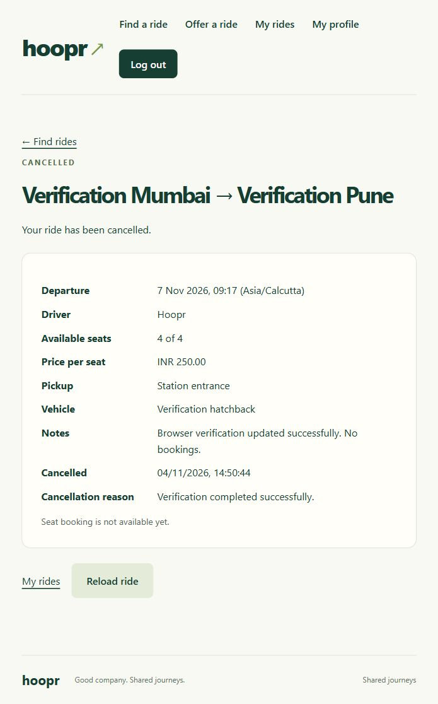
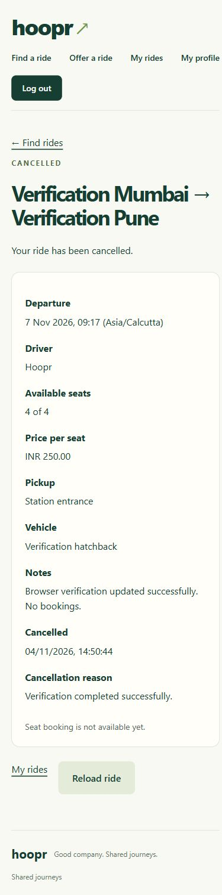

# Hoopr verification — 4 November 2026

Fresh verification of the implemented Phases 1–3, followed by starting both projects. This report records this session's results rather than reusing the historical checks from 3 November.

## Running application

| Component | URL | Result |
| --- | --- | --- |
| Frontend | http://localhost:5173 | Running; home opened in the in-app browser |
| Backend health | http://localhost:8080/api/v1/health | HTTP 200, UP |
| Actuator health | http://localhost:8080/actuator/health | HTTP 200, UP |
| Frontend API proxy | http://localhost:5173/api/v1/health | HTTP 200, UP |
| Frontend route fallback | http://localhost:5173/rides | HTTP 200, React entry served |

Both processes were left running in the background. At verification time the backend PID was 12044 and frontend PID was 19336. PIDs are a session snapshot and can change or be reused after a process exits; verify process identity before stopping anything later.

Logs (ignored build output):

- backend/target/hoopr-running.stdout.log
- backend/target/hoopr-running.stderr.log
- backend/target/hoopr-frontend.stdout.log
- backend/target/hoopr-frontend.stderr.log

## Fresh automated checks

| Check | Result |
| --- | --- |
| Maven full verify including *Test and *IT | 62 passed, zero failures/errors/skips; executable JAR packaged |
| PostgreSQL integration database | hoopr_test only; test guard confirmed in source |
| Flyway | V1–V4 validated; running application schema is at V4 |
| Frontend Vitest | 32 passed in 5 test files |
| Frontend TypeScript and Vite build | Passed through npm run build |
| Secret logging / token storage source scan | No application token/password logging or localStorage/sessionStorage usage found in scanned main source; unexpected errors log only exception class |

Commands executed:

```powershell
# backend/, with privately supplied test environment:
mvn -B '-Dmaven.repo.local=../.maven-repository' '-Dtest=*Test,*IT' verify
# frontend/:
npm.cmd test
npm.cmd run build
```

The automated suite covers authentication, BCrypt, JWT validation/expiry, refresh rotation/reuse, logout, roles, CSRF/origins/cookies/CORS, health, ride identity/ownership, validation, search/pagination/time zones, constraints and concurrent ride updates.

Installed tools observed during this verification: JDK 25.0.4.1, Node 24.22.1, npm 11.19.1. The project still compiles to Java 21; execution on an actual JDK 21 remains unverified.

## Interactive browser checks

The running frontend was tested through its actual UI and API proxy against the local development application:

1. Home and registration page loaded.
2. Created one throwaway verification account, choosing Both. Registration succeeded.
3. Logged in and reached the profile. USER role and Both preference were displayed.
4. Reloaded the page; the HttpOnly refresh-cookie flow restored the authenticated session.
5. Created a future Verification Mumbai → Verification Pune ride with 3 seats and INR 250.00.
6. Confirmed safe driver display, timezone, optional vehicle description and notes on details.
7. Found that ride using mixed-case origin/destination prefixes, 3 seats and maximum price 300.
8. Opened the owner edit form, changed capacity to 4 and updated notes. Saved changes appeared on details.
9. My Rides showed the owner's updated offer.
10. Opened cancellation confirmation; Keep ride closed the dialog with SCHEDULED status preserved.
11. Confirmed cancellation with a verification reason. The record and reason remained visible, while edit/cancel controls disappeared.
12. Public search then showed no available rides from the verification offer.
13. Checked details and search at a 390 × 844 viewport. No horizontal overflow was measured, and the mobile detail layout was visually inspected. Reset the viewport afterwards.
14. Logged out. Visiting /profile redirected to /login.
15. Returned to home and kept the app tab open for the user.

The generated password was not printed or saved in this report. The throwaway account and cancelled verification ride remain in the development database as normal application history; no account/table/history was deleted. Ride ID: 30268cb6-6130-4567-9de6-6d9337b86f15.

### Desktop proof



### Mobile proof



## Configuration adjustment

backend/.env had no JWT_SECRET. A cryptographically random signing key was generated privately and saved in that existing ignored file before startup. Git ignore status was checked. The value was not printed. Backend settings were loaded into the process explicitly because Spring Boot does not automatically load .env.

No application source code changed during this verification. The backend uses the existing workspace-specific temporary-socket workaround for the installed JDK: -Djdk.net.unixdomain.tmpdir=backend/target. It does not change global Java/security settings.

## What is complete and what remains

- Foundation/health, authentication and refresh-session security, travel preferences, and ride offer/search/details/owner editing/cancellation are implemented and passed the checks above.
- Bookings, payments, reservation-based ride cancellation, ride start/completion controls, verified vehicle onboarding, maps, notifications and password recovery remain unimplemented as previously scoped.
- Login throttling is per process. Existing access JWTs can remain valid until their 15-minute expiry after logout. Separate tabs can trigger conservative refresh-family replay revocation.
- Location matching is basic case-insensitive prefix search; multi-currency amounts are not converted.
- This was a desktop browser walkthrough plus a narrow viewport check, not an exhaustive device/accessibility/security penetration test. Invalid/ownership/concurrency cases were primarily covered by automated tests rather than repeated manually through every browser screen.
- Minor observed presentation polish: the footer repeats the Shared journeys tagline, and the singular search count displays “1 rides found”. These do not block the verified flows and were left unchanged during this verification/run request.
- Postman collections were not re-executed in this session; earlier collection results remain historical. This session used fresh automated tests and the interactive browser checks above.

See ../SETUP.md for starting/stopping/configuration steps, ../PHASE_SETUP.md for phase status/prompts, and phase-3-rides.md for the complete API contract and manual checklist.
